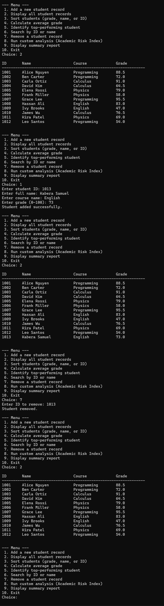
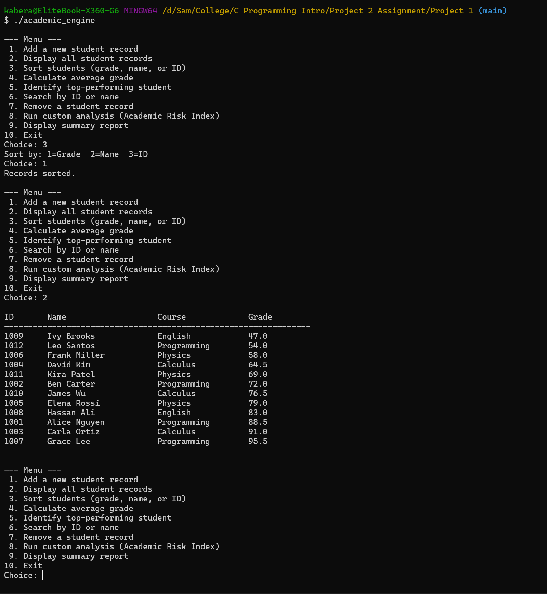
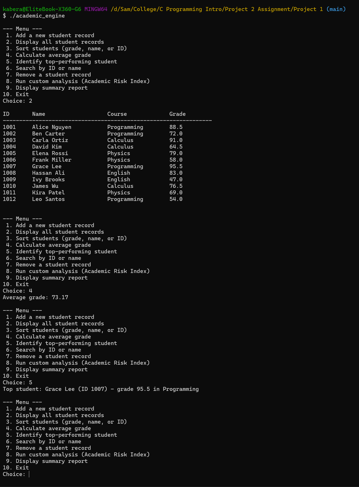
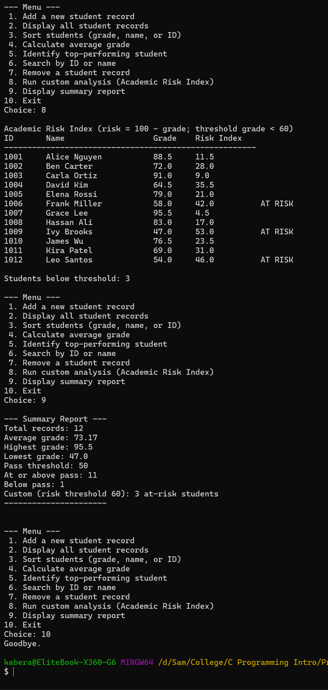
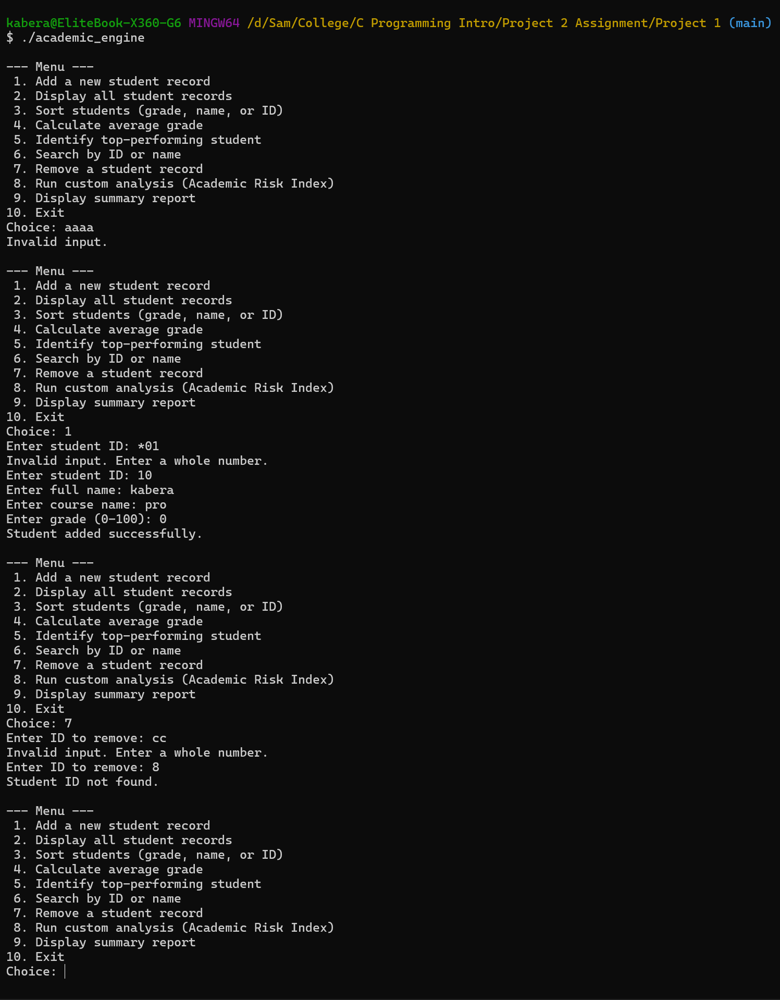

# Project 1: Academic Engine

I built a console menu program in C to manage student records (ID, name, course, grade). I split the code into `main.c` (menu and input loop) and `student.c` / `student.h` (data and operations) so I could keep each part easy to read and grade.

I store students in a dynamic array on the heap (`malloc` / `realloc` / `free`) so I can add and remove records without a fixed list size. The program starts with 12 sample students loaded in `init_students()`.

## How to run

Compile:

```bash
gcc -o academic_engine main.c student.c
```

Run:

```bash
./academic_engine
```

On Windows you can run `academic_engine.exe` after building.

## What I implemented

- **Menu (options 1-10)**: I wired each choice to a function so I could test features one at a time.
- **Add / remove**: I check for duplicate IDs when adding and shift the array when removing so there are no gaps.
- **Display & sort**: I list all records and sort by grade, name, or ID using a simple bubble sort.
- **Average & top student**: I walk the list with pointers to compute the average and find the highest grade.
- **Search**: I search by student ID or exact name.
- **Custom analysis**: I compute an Academic Risk Index (`100 - grade`) and flag students whose grade is below 60 as **AT RISK**.
- **Summary report**: I print totals, average, highest/lowest grades, pass/fail counts (pass >= 50), and at-risk count.
- **Input validation**: I reject bad menu choices, non-numeric input, out-of-range IDs and grades, and duplicate IDs so the program does not crash on mistakes.

## Screenshots

### Add and remove a student



### Sort students



### Average grade and top student



### Custom analysis and summary report



### Invalid input (negative checks)


