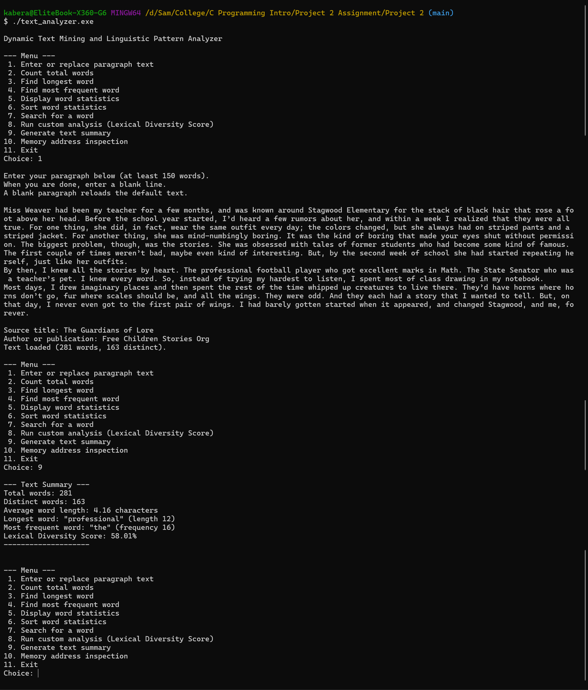
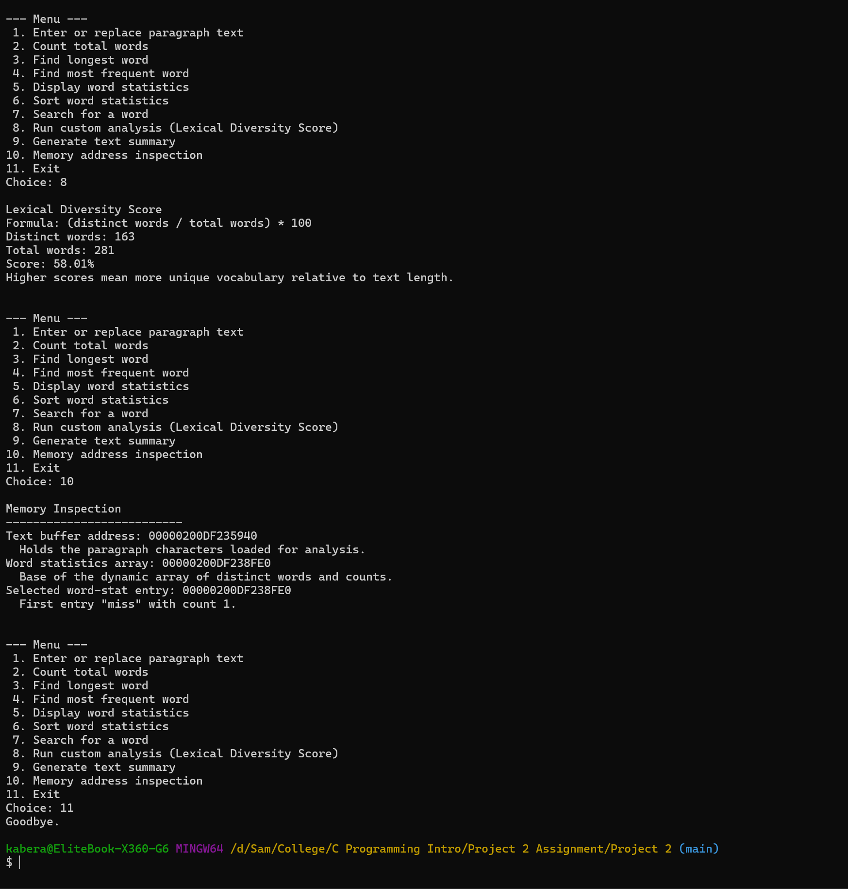

# Project 2: Dynamic Text Mining and Linguistic Pattern Analyzer

I built a C console program that takes a paragraph, breaks it into words, and then you can look at stats from a menu. I put the menu in `main.c` and the actual text/word logic in `text.c` and `text.h`.

The paragraph sits in a buffer on the heap, and each unique word goes into a `WordStat` array (`name` + `count`). If the text or the word list gets bigger I grow it with `realloc`.

## How to run

```bash
gcc -o text_analyzer main.c text.c
./text_analyzer
```

On Windows just run `text_analyzer.exe`.

## Selected paragraph

- **Title:** The Guardians of Lore
- **Publication:** Free Children Stories Org
- **Size:** 281 words, 163 distinct. I typed/pasted it in option 1. The program wont take it if its under 150 words.
- If you leave it blank it loads the start of _A Tale of Two Cities_ (Charles Dickens) instead, thats 186 words.

## How I implemented it

- **Structure:** `WordStat` is just the word and how many times it showed up. Name can be 39 chars max (`name[40]`).
- **Function pointers:** in `main.c` I made an array of function pointers (`AnalysisHandler`) for menu 1-10. So when you pick a number it calls that function.
- **Pointers:** I move through the text with a `char `\*, skip that characters that are not letters, then copy the letters into a token.
- **String functions:** `strcmp()` to see if I already have that sword, `strlen()` for length, `strcpy()` when I add a new one.
- **How I treat words:** only letters count. I store them lowercase. Commas, apostrophes, hyphens etc I treat as a break, so `don't` becomes `don` and `t`. If a word is longer then 39 characters I cut it so it fits.
- **Memory:** `malloc` / `realloc` for the buffer and the stats, I check if it failed, and I `free` everything when you exit.

## Custom analysis: Lexical Diversity Score

I wanted something that shows if the writing uses alot of different words or if it repeats the same ones.

- **Formula:** `(distinct words / total words) * 100`
- **My paragraph:** `(163 / 281) * 100 = 58.01%`
- Higher score = more unique words. Words like `the` showing up over and over brings it down.

Summary also has average word length. Here's how it's calculated

`(sum of each word's length * how many times it appears) / total words`

Punctuation and spaces dont go in. For this paragraph it came out 4.16.

## Screenshots

### Enter text and summary

Option 1 to load the paragraph, then option 9 for the summary. 281 words, 163 distinct, longest is `professional`, most frequent is `the`.



### Custom analysis and memory inspection

Option 8 is the lexical diversity score, option 10 is the memory addresses.



If you want to see the whole run (count, longest, search, sort, the big frequency list, etc) its in [whole-test-run.png](screenshots/whole-test-run.png). Theres also:

- [Word count and longest word](screenshots/word-count-and-longest-word.png)
- [Search for a word](screenshots/search-for-word.png)
- [Frequent word and all-word statistics](screenshots/frequent-word-and-all-words-statistics.png)
