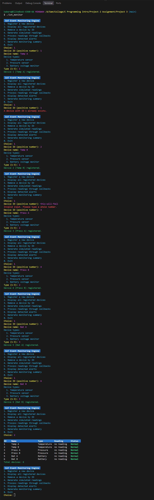
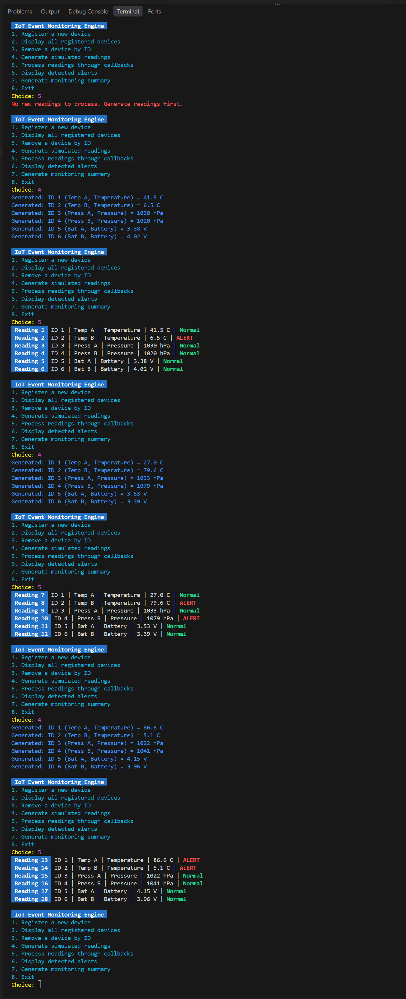
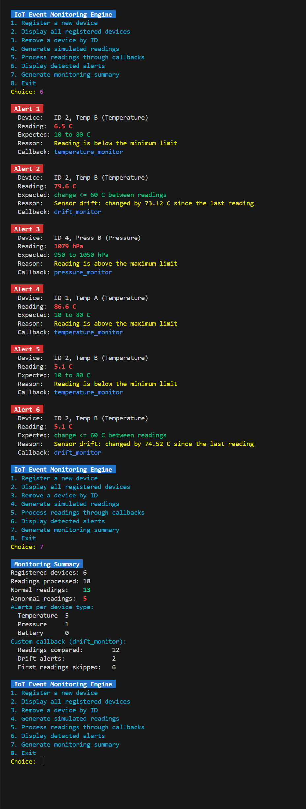

# Project 3: Dynamic IoT Event Monitoring and Callback Engine

I built a C console program that pretends to be a small IoT system. You add devices, the program makes random readings for them, and each reading is checked by a function (a callback). If a reading is bad it becomes an alert, and at the end you can see a summary.

The code is split in following files:

- `main.c`: the menu and the user input.
- `device.c` / `device.h`: the device struct and the list of devices.
- `monitor.c` / `monitor.h`: readings, callbacks, alerts and the summary.
- `colors.h`: colors, so the menu, input, readings and alerts are easy to tell apart.

## How to run

```bash
gcc -o iot_monitor main.c device.c monitor.c
./iot_monitor
```

On Windows just run `iot_monitor.exe`. It starts with no devices, so pick option 1 first.

## How I implemented it

- **Device struct and union:** each device has an id, a name, a type, a status and a reading. The reading is a union, because a device only has one kind of reading (temperature, pressure or voltage). The type of the device tells me which one to use, so I never read the wrong one.
- **Dynamic list of devices:** the devices are in an array on the heap. When I register a device I make it 1 bigger with `realloc`, and when I remove one I make it 1 smaller. When the last one is removed the memory is freed.
- **Memory checks:** I check every `realloc`. If it fails the program says so and keeps the old data. Everything is freed when the program exits.
- **Duplicate IDs:** before adding a device I search the list, and if the ID is already used it is refused.
- **Pointers:** to go through the devices I use a pointer from the start of the array to the end, so I dont go outside the array. Removing a device moves the next ones one step back so the other devices keep their data.
- **Input checks:** I read each line and check it is a real number, so wrong input just asks again.

## Readings (menu 4 and 5)

- Option 4 makes a random reading for every device (using `rand()`).
- Option 5 checks the readings and prints one line each with the reading number, device, value and Normal or ALERT.
- I can repeat 4 and 5 as many times as I want. In my demo there were 6 devices and 18 readings.

The ranges are a bit wider than the normal limits on purpose, so some readings are abnormal:

| Type            | Generated range | Normal limit    |
| --------------- | --------------- | --------------- |
| Temperature     | 0 to 95 C       | 10 to 80 C      |
| Pressure        | 920 to 1080 hPa | 950 to 1050 hPa |
| Battery voltage | 3.2 to 4.3 V    | 3.3 to 4.2 V    |

## Callbacks and function pointers

- Every device type has its own callback: `temperature_monitor`, `pressure_monitor` and `battery_monitor`. Each one checks its reading against the limits above.
- I keep these functions in an array, and the device type picks which one runs.
- `process_device()` takes a device and a callback and calls it.
- Every alert shows which callback made it.

## Custom callback: Sensor Drift Detector

- **What it does:** it finds sensors that jump too much from the last reading, even if the new value is still inside the normal limits.
- **How it works:** `change = |new reading - old reading|`. If the change is bigger than the limit for that type, it makes an alert.
- **Limits:** temperature 60 C, pressure 110 hPa, battery 0.8 V.
- **First reading:** there is no old reading to compare, so it is skipped (the summary counts these).
- **Example from my run:** Temp B changed by 73.12 C, which is more than 60 C, so `drift_monitor` gave an alert.

## Alerts (menu 6)

Every alert shows the device ID and name, the reading with unit, the expected range, the reason and the callback that made it.

Note:

- The alert list is a **history**. It keeps all alerts since the program started, not only the last round; This is why alerts and summary screenshot you can see that they were 6 alerts eventough the last run showed only 2 alerts.
- One reading can make **2 alerts** (one from the limit check and one from the drift check), but it still counts as 1 abnormal reading.

## Monitoring summary (menu 7)

It shows the number of devices, readings processed, normal and abnormal readings, alerts per device type, and the results of the custom callback.

My demo run: 6 devices, 18 readings, 13 normal and 5 abnormal. For the drift callback, 12 readings were compared, 2 were drift alerts and 6 first readings were skipped (12 + 6 = 18).

## Screenshots

### Registering devices



### Simulated readings



### Alerts and monitoring summary



If you want to see the whole run from start to end, its in [complete-program-run.png](screenshots/complete-program-run.png).
